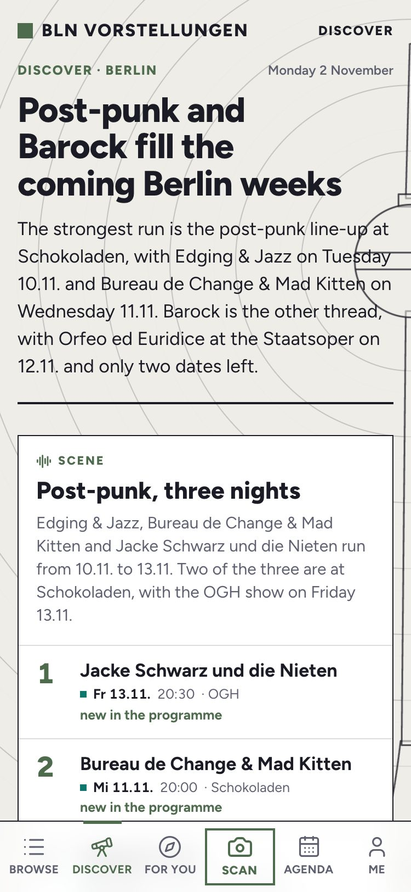
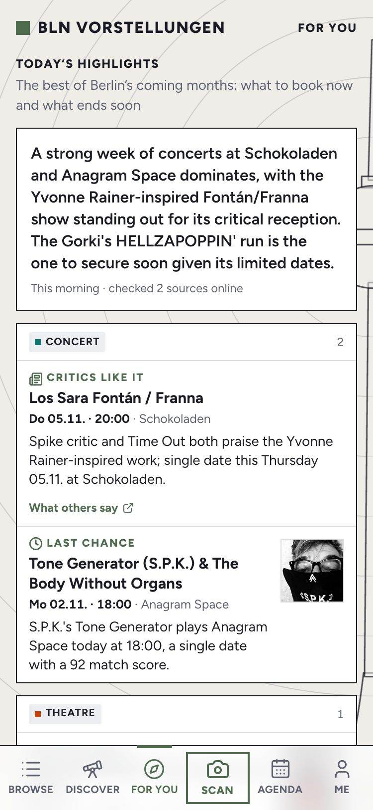

# BLN Vorstellungen

**What's on in Berlin tonight, read from the venues' own programmes, ranked for your taste.**

### → [bln-vorstellungen.aliaksei-zhynhiarouski.workers.dev](https://bln-vorstellungen.aliaksei-zhynhiarouski.workers.dev)

  
  
  
  

Berlin has hundreds of stages, and each one publishes its programme its own way: a calendar feed here, a Spielplan
page there, a Luma list somewhere else. BLN Vorstellungen reads them all and turns them into one calm list. Tell it
in a sentence what you like, and it ranks every upcoming event for you and says why.

## What makes it good

- **A daily front page.** Discover leads with what stands out in the coming weeks (a scene, a venue, a far-ahead
  booking), written fresh each morning, for you or for the city.
- **Highlights that tell you why now.** For you picks what to book early, what is made for you, last chances and
  what critics say, after looking up reviews online.
- **One list for the whole city.** Theatre, opera, concerts, clubs and talks side by side. A production with twelve
  performances is one entry, not twelve rows.
- **AI reads the venue pages.** Claude reads Spielplan pages that have no feed: every date, price and room.
- **Ranked for your taste.** Describe what you like in a sentence; every event gets a score and a one-line reason.
  Swipe to sort.
- **Search by meaning.** "Something fun with kids" finds the Kinder Rave.
- **Agenda in your calendar.** Your picks by day, clashes flagged, synced to Google or Apple Calendar.
- **Made for Berlin.** German and English, "Fr 30.10. · 20:00", "ab 18 €", "frei". Light and dark.

  
  

## Where the events come from

**Theatre and performance:** Berliner Ensemble · Deutsches Theater · Maxim Gorki Theater · HAU Hebbel am Ufer ·
Radialsystem · Bar jeder Vernunft. **Opera and new music:** Staatsoper Unter den Linden · field notes (Berlin's
new-music calendar) · KM28. **Concerts and clubs:** SO36 · Schokoladen · Cassiopeia · Badehaus · Madame Claude ·
Privatclub · A-Trane · Panke Culture · OGH and LOGE (Telegram). **Art:** Index Berlin gallery openings. **Guides:**
Berlin Gig Guide · The Next Day · Luma Berlin · The Left Berlin. **Communities:** RAZAM (Belarusian) · Stand Up
Berlin (Russian-language comedy) · Siegessäule's sex calendar and Lab.oratory (opt-in). Each is checked on its own
schedule, every 2 to 24 hours.
Adding a venue is one entry, not new code.
