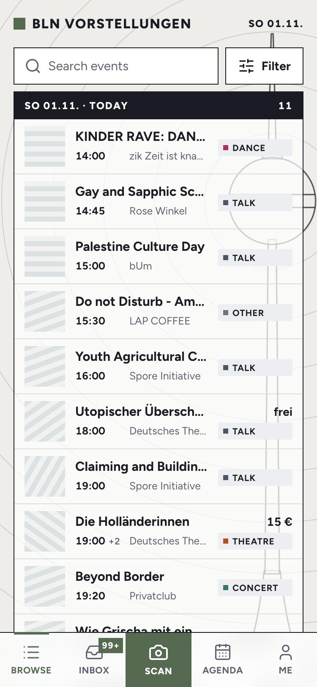
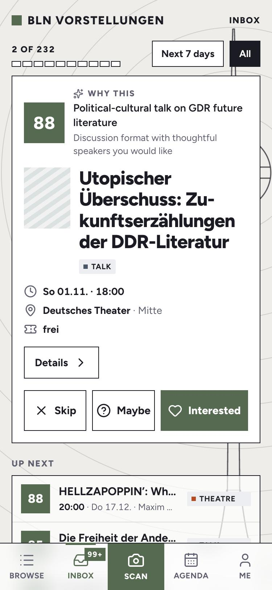
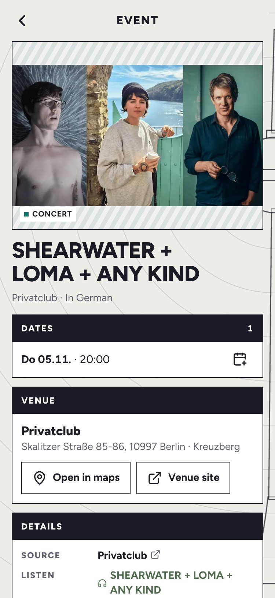
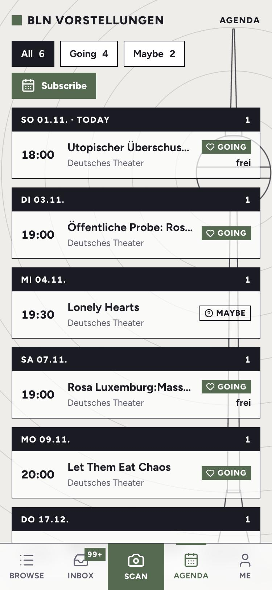
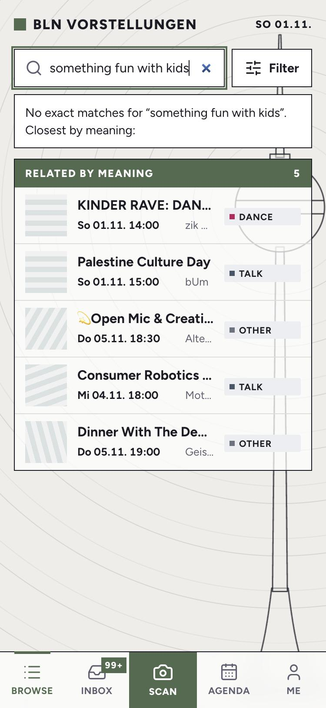
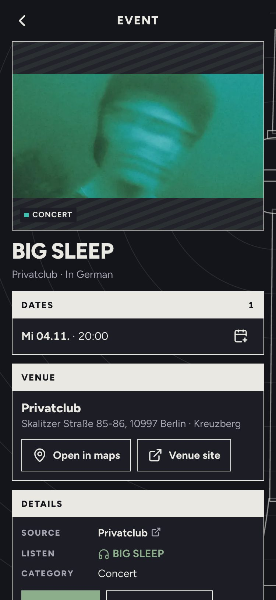

# BLN Vorstellungen

**What's on in Berlin tonight, read from the venues' own programmes, ranked for your taste.**

### → [bln-vorstellungen.aliaksei-zhynhiarouski.workers.dev](https://bln-vorstellungen.aliaksei-zhynhiarouski.workers.dev)

<p align="center">
  
  
  
  
</p>

Berlin has hundreds of stages, and each one publishes its programme its own way: a calendar feed here, a Spielplan
page there, a Luma list somewhere else. BLN Vorstellungen reads them all and turns them into one calm list. Tell it
in a sentence what you like, and it ranks every upcoming event for you and says why.

## What makes it good

**One list for the whole city.** Theatre, opera, concerts, clubs, talks, exhibitions and community events from
venue calendars, venue websites and Luma, side by side. A production with twelve performances is one entry with
twelve dates, not twelve rows. The same event from two sources shows up once.

**AI reads the programmes no feed covers.** Most theatres only publish a web page. Claude reads those Spielplan
pages like a person would: titles, every date, prices, the room ("Großes Haus", "Kammer"), premieres, "nur noch
wenige Karten". It skips a house's guest performances in other cities and ignores anything on a page that tries to
give it instructions.

**Your own inbox, ranked with reasons.** Describe your taste in plain words ("contemporary dance, political talks,
jazz in small clubs; not into techno"). Every upcoming event gets a 0–100 score and a one-line reason you can
check: *"Contemporary theatre by Kae Tempest, a strong match."* Swipe right for interested, left to skip, or use
the keyboard (j/k, i, m, x, u). Hidden events never come back.

**Search by meaning.** "Something fun with kids" finds the Kinder Rave even though no title says "kids". Every
event page shows more like it.

**An agenda that lives in your calendar.** What you're going to and what's a maybe, by day, with clashes flagged.
Subscribe once in Google or Apple Calendar and it stays up to date.

**Made for Berlin.** German and English side by side, never auto-translated. Berlin formats throughout:
"Fr 30.10. · 20:00", "ab 18 €", "frei". Phone first, works in light and dark, with the Fernsehturm in the
background.

<p align="center">
  
  
</p>

## Open to everyone, personal for a few

Anyone can browse, search and open events, no account needed. The ranked inbox, agenda and calendar feed are for
invited people: the owner creates an account and sends a one-time login link. No passwords, no sign-up forms, no
Google login.

## Where the events come from

The Left Berlin · Luma Berlin · Maxim Gorki Theater · Berliner Ensemble · Deutsches Theater · Staatsoper Unter den
Linden · A-Trane · Privatclub · Bar jeder Vernunft. Each is checked on its own schedule, every 6 to 24 hours.
Adding a venue is one entry, not new code.

## Under the hood

One Cloudflare Worker serves the site and the API, runs the schedule and keeps everything in D1. Event pages
without a feed are read by Claude Haiku through Cloudflare's AI Gateway; matching and search by meaning use
Workers AI embeddings. It all runs on Cloudflare's free plan, and the AI costs a few cents a day.

<details>
<summary>For developers</summary>

TypeScript throughout: Hono on Workers, D1 with Drizzle, Workflows, KV, Workers AI, React 19 with Vite, TanStack
and Tailwind. Notes on the design and architecture are in [`docs/`](docs/), decisions in
[`docs/09-decisions.md`](docs/09-decisions.md).

```bash
pnpm install
pnpm --filter @bln/worker db:migrate:local          # local D1
pnpm --filter @bln/worker db:seed-sources:local     # the venues above
pnpm dev                                            # Worker + app on :8787
pnpm typecheck && pnpm lint && pnpm test
pnpm run deploy                                     # build + wrangler deploy
```

The admin API takes `Authorization: Bearer $ADMIN_TOKEN` (local value in `apps/worker/.dev.vars`, remote via
`wrangler secret put ADMIN_TOKEN`) or an owner's session:

```bash
# Invite someone: creates the account and returns a one-time login link (7 days)
curl -X POST -H "authorization: Bearer $ADMIN_TOKEN" -H 'content-type: application/json' \
  -d '{"name":"Ada","email":"ada@example.org"}' https://…/api/admin/users

# Add a venue
curl -X POST -H "authorization: Bearer $ADMIN_TOKEN" -H 'content-type: application/json' \
  -d '{"name":"My venue","type":"html","config":{"url":"https://venue.example/programm"}}' \
  https://…/api/admin/sources

# Try what the AI reads from a page before adding it
curl -X POST -H "authorization: Bearer $ADMIN_TOKEN" -H 'content-type: application/json' \
  -d '{"url":"https://venue.example/spielplan"}' https://…/api/admin/extract
```

Source types: `ical`, `jsonld`, `html` (read by the AI) and `rss`. Claude is used when an Anthropic key is stored
on the `default` AI Gateway; otherwise the free Workers AI model takes over.

</details>
