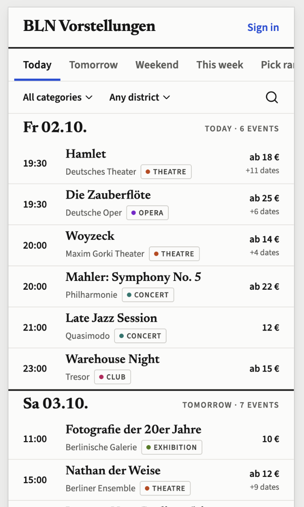

# BLN Vorstellungen

<p align="center"></p>

A personal, AI-assisted overview of events in Berlin: concerts, theatre, opera, clubs, talks, exhibitions and
whatever else is worth leaving the flat for.

Events are **sourced** automatically (websites, RSS, iCal, Telegram channels, newsletters) or manually (a photo of a
poster, a pasted text), **normalized** into one event model, **enriched** with data from the web, and then
**scored** against each user's taste profile. A public, non-personalized view lists everything; signed-in users
get a ranked "for you" feed. An MCP server exposes the same data to Claude and other agents.

> Status: **phase 1** (public list from structured sources: iCal and JSON-LD adapters, scheduled source runs,
> admin API). Live: https://bln-vorstellungen.aliaksei-zhynhiarouski.workers.dev · Mockup:
> https://bln-vorstellungen-mockup.aliaksei-zhynhiarouski.workers.dev

## Development

```bash
pnpm install
pnpm --filter @bln/worker db:migrate:local   # create the local D1 database
pnpm --filter @bln/worker db:seed:local      # optional sample events for UI work
pnpm dev                                     # builds the web app, then serves Worker + app on :8787
pnpm dev:web                                 # Vite with hot reload on :5173, API proxied to :8787
pnpm typecheck && pnpm lint && pnpm test
pnpm deploy                                  # build web + wrangler deploy
```

Remote schema changes: `pnpm --filter @bln/worker db:generate`, then `db:migrate:remote` before deploying.

### Sources

Sources live in the `sources` table and run every 6–12 h from the 15-min cron. Starter set:
`pnpm --filter @bln/worker db:seed-sources:local` (or `:remote`). Manage them through the admin API, gated by a
shared secret until sign-in exists (local value in `apps/worker/.dev.vars`, remote via
`wrangler secret put ADMIN_TOKEN`):

```bash
curl -H "authorization: Bearer $ADMIN_TOKEN" https://…/api/admin/sources              # list with last status
curl -X POST -H "authorization: Bearer $ADMIN_TOKEN" -H 'content-type: application/json' \
  -d '{"name":"My venue","type":"jsonld","config":{"url":"https://venue.example/programm","category":"concert"}}' \
  https://…/api/admin/sources                                                             # add; runs on the next tick
curl -X POST -H "authorization: Bearer $ADMIN_TOKEN" https://…/api/admin/sources/<id>/run  # run now
```

Adapter types so far: `ical`, `jsonld` (mapped directly) and `rss` (stored for LLM extraction in phase 3).

## Documents

| Doc | What it covers |
| --- | --- |
| [01 Functionality](docs/01-functionality.md) | What the product does, for whom, screen by screen |
| [02 Architecture](docs/02-architecture.md) | Tech stack, Cloudflare components, free-tier budget, the Kotlin question |
| [03 Sourcing](docs/03-sourcing.md) | The generic source adapter model and the catalogue of Berlin sources |
| [04 Data model](docs/04-data-model.md) | Tables, the event vs. performance distinction, dedup keys |
| [05 AI pipeline](docs/05-ai-pipeline.md) | Extraction, enrichment, web research, scoring, search; model choice and cost |
| [06 MCP](docs/06-mcp.md) | MCP tools, resources, auth |
| [07 UI](docs/07-ui.md) | UX principles, reference sites to study, brief for a design tool |
| [08 Execution plan](docs/08-execution-plan.md) | Phased delivery plan written for the implementing model |
| [09 Decisions](docs/09-decisions.md) | Short decision log with the alternatives that were rejected |

## Stack in one paragraph

One Cloudflare Worker written in **TypeScript** (Hono) serves the JSON API, the MCP endpoint, the cron entry point and
the email ingest handler, and ships the **React + Vite + Tailwind + shadcn/ui** frontend as static assets.
Data lives in **D1** (SQLite) with **R2** for uploaded images, **KV** for caches, **Workflows** for source runs and
AI pipelines, a **Durable Object** for the MCP session and a **cron trigger** for scheduling.
LLM work uses **Workers AI** for cheap bulk steps and **Claude** (via AI Gateway) for extraction and scoring that needs
quality. Everything fits the Workers Free plan at hobby volume; the only expected recurring cost is a few cents of
Claude API usage per day. See [02 Architecture](docs/02-architecture.md) for why not Kotlin.

## Working on this repo

- `CLAUDE.md` holds the standing instructions for the model that implements the plan.
- Decisions that change the plan go into `docs/09-decisions.md` first, then the code.
